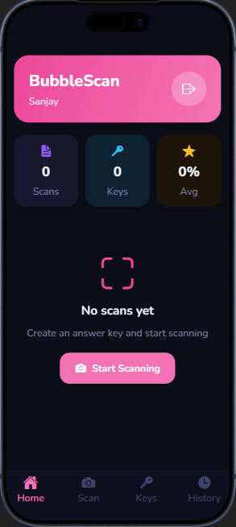

# BubbleScan

<p align="center">
  <strong>Smart OMR & Bubble Sheet Scanner</strong>
</p>

<p align="center">
  Scan, analyze, and digitize bubble sheets directly from your device.
</p>

<p align="center">
  <a href="https://bubble-sheet-viewer--sanjayrajendra1.replit.app/">
    
  </a>
  <a href="https://github.com/sanjuz-cas/Bubble-Sheet-Viewer">
    
  </a>
</p>

<p align="center">
  
  
  
</p>

---

## 📱 What is BubbleScan?

**BubbleScan** is a mobile-first OMR and bubble-sheet scanning application that turns a camera-captured answer sheet into structured, machine-readable responses.

It is designed to make OMR evaluation faster and more accessible without requiring dedicated OMR scanning hardware.

> **Point. Scan. Analyze.**

**10,000+ users** have used BubbleScan.

### 🚀 Try BubbleScan

**[Launch the application →](https://bubble-sheet-viewer--sanjayrajendra1.replit.app/)**

---

## ✨ Features

- 📷 **OMR Sheet Scanning** — Capture bubble sheets using a mobile camera.
- 🔍 **Automatic Bubble Detection** — Identify marked and unmarked bubbles.
- ⚡ **Automated Processing** — Reduce manual answer-sheet evaluation.
- 📊 **Result Visualization** — Review detected responses in a clear interface.
- 📱 **Mobile-first Experience** — Built around practical mobile usage.
- 🧪 **Testing Pipeline** — Includes testing infrastructure for OMR processing.
- 🗂️ **OMR Resources** — Includes sample/generated OMR sheet resources.

---

## 🖥️ Application Preview

> Add your polished screenshots to `assets/images/` using the filenames below.

<p align="center">
  
</p>

<p align="center">
  <em>BubbleScan — OMR scanning and analysis interface</em>
</p>

### Recommended showcase

For the most professional GitHub presentation, create one image containing **3 phone mockups**:

```text
┌─────────────┐   ┌─────────────┐   ┌─────────────┐
│   Home      │   │    Scan     │   │   Results   │
│             │   │             │   │             │
│ BubbleScan  │   │  Camera     │   │  Detected   │
│             │   │  OMR Sheet  │   │  Answers    │
└─────────────┘   └─────────────┘   └─────────────┘
```

Save that final composition as:

```text
assets/images/bubblescan-ui.png
```

This looks considerably cleaner than placing raw screenshots directly into the README.

---

## 🧠 How it works

```text
       Mobile Camera
             │
             ▼
     ┌─────────────────┐
     │  Image Capture  │
     └────────┬────────┘
              │
              ▼
     ┌─────────────────┐
     │  Preprocessing  │
     └────────┬────────┘
              │
              ▼
     ┌─────────────────┐
     │ Bubble Detection │
     └────────┬────────┘
              │
              ▼
     ┌─────────────────┐
     │ Answer Extraction│
     └────────┬────────┘
              │
              ▼
     ┌─────────────────┐
     │ Results / Viewer │
     └─────────────────┘
```

---

## 🏗️ Project Structure

```text
Bubble-Sheet-Viewer/
│
├── app/                # Application screens and routes
├── assets/images/      # UI and application assets
├── components/         # Reusable UI components
├── constants/          # Application constants
├── contexts/           # Application state/context
├── lib/                # Shared utilities
│
├── server/             # Backend services
├── shared/             # Shared application logic
│
├── omr_sheets/         # OMR sheet resources
├── scripts/             # Utility scripts
├── test/                # Test cases
├── testing/             # Testing infrastructure
├── train/               # Training / processing code
│
├── main.py              # Python entry point
├── package.json         # Node.js dependencies and scripts
├── pyproject.toml       # Python project configuration
├── app.json             # Application configuration
└── README.md
```

---

## 🛠️ Technology

| Area | Technology |
|---|---|
| Application | React Native / Expo |
| Frontend | TypeScript |
| Backend / Processing | Python |
| Database Layer | Drizzle ORM / SQL |
| Image Processing | Computer Vision |
| Testing | Python testing infrastructure |
| Development | Replit / Expo |

---

## ⚙️ Getting Started

### Prerequisites

Make sure you have:

- Node.js
- npm
- Python 3.x
- Expo-compatible development environment

### Clone the repository

```bash
git clone https://github.com/sanjuz-cas/Bubble-Sheet-Viewer.git
cd Bubble-Sheet-Viewer
```

### Install JavaScript dependencies

```bash
npm install
```

### Install Python dependencies

If your environment uses a requirements file:

```bash
pip install -r requirements.txt
```

Or install the project according to the dependencies declared in `pyproject.toml`.

### Start development

```bash
npm run dev
```

Then follow the Expo development instructions to open BubbleScan on a compatible device.

---

## 📲 Using BubbleScan

1. Open BubbleScan.
2. Capture an OMR / bubble sheet.
3. Allow the image to be processed.
4. The system detects the marked bubbles.
5. Review the extracted responses and results.

---

## 🎯 Why BubbleScan?

Traditional OMR workflows often depend on dedicated scanners or manual evaluation.

BubbleScan brings the workflow closer to the user by using a mobile device as the capture interface.

The objective is simple:

> **Make bubble-sheet evaluation as easy as taking a photo.**

---

## 📈 Adoption

### 10K+ Users

BubbleScan has reached **10,000+ users**, demonstrating practical adoption of the mobile OMR workflow.

---

## 🤝 Contributing

Contributions, suggestions, bug reports, and improvements are welcome.

1. Fork the repository.
2. Create a feature branch.
3. Make your changes.
4. Test your changes.
5. Commit and push your branch.
6. Open a pull request.

---

## 📄 License

See the repository license and project configuration for licensing information.

---

## 🔗 Links

- **Live Application:** [BubbleScan](https://bubble-sheet-viewer--sanjayrajendra1.replit.app/)
- **Source Code:** [GitHub Repository](https://github.com/sanjuz-cas/Bubble-Sheet-Viewer)

---

<p align="center">
  Built with ❤️ by <a href="https://github.com/sanjuz-cas">Sanjay Rajendra</a>
</p>
